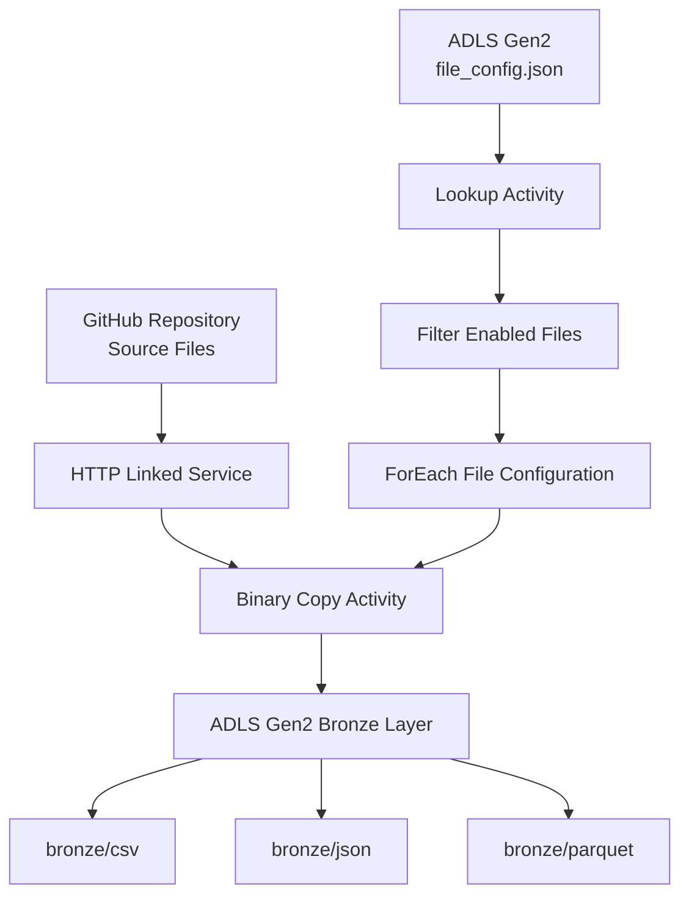

# Bronze Layer -- Raw Data Ingestion

## 1. Overview

The Bronze layer is the raw-data landing zone of the Multi-Format Retail
Data Engineering project.

Its purpose is to ingest source files from a GitHub repository into
Azure Data Lake Storage Gen2 (ADLS Gen2), preserve their original file
contents and formats, and organize them into format-specific folders.

The ingestion process is configuration-driven. Azure Data Factory (ADF)
reads a JSON configuration file, filters enabled file entries, iterates
through the resulting list, and dynamically copies each source file into
its designated Bronze folder.

## 2. Business Scenario

A retail organization receives files from multiple business systems.
These files may arrive in CSV, JSON, and Parquet formats.

The ingestion solution should:

-   Support multiple file formats.
-   Avoid creating a separate Copy activity for every file.
-   Dynamically construct source file paths.
-   Route files to the appropriate destination folders.
-   Preserve the original source file contents.
-   Allow additional files to be registered through configuration.

## 3. Architecture



### Architecture explanation

1.  GitHub stores the retail source files.
2.  ADLS Gen2 stores the ingestion configuration file.
3.  ADF Lookup reads the configuration.
4.  Filter selects only enabled file entries.
5.  ForEach processes each selected file configuration.
6.  Copy Data downloads the source file over HTTP and writes it to ADLS
    Gen2 using Binary format.
7.  The destination directory and filename are determined dynamically
    from the configuration.

## 4. Azure Resources Used

  -------------------------------------------------------------------------
  Resource                Name                      Purpose
  ----------------------- ------------------------- -----------------------
  Resource Group          `multi-format-project`    Groups project
                                                    resources

  Data Factory            `mfp-azure-factory`       Orchestrates ingestion

  Storage Account         `globalstorageprojects`   Stores raw data

  ADLS Container          `retail-data`             Project data container

  HTTP Linked Service     `LS_HTTP_GitHub`          Connects to GitHub raw
                                                    files

  ADLS Linked Service     `LS_ADLS_Retail`          Connects to ADLS Gen2
  -------------------------------------------------------------------------

**Region:** Central India.

## 5. Source Data

**GitHub repository:** `narencloudev/azure-data-engineering`

**Project source directory:** `multi-format-project/source-data/`

  Source file          Format    Destination
  -------------------- --------- ------------------
  `customer.csv`       CSV       `bronze/csv`
  `sales.csv`          CSV       `bronze/csv`
  `inventory.csv`      CSV       `bronze/csv`
  `orders.json`        JSON      `bronze/json`
  `products.parquet`   Parquet   `bronze/parquet`

## 6. ADLS Folder Structure

``` text
retail-data/
├── bronze/
│   ├── csv/
│   │   ├── customer.csv
│   │   ├── sales.csv
│   │   └── inventory.csv
│   ├── json/
│   │   └── orders.json
│   └── parquet/
│       └── products.parquet
├── silver/
├── gold/
├── error/
├── logs/
└── config/
    └── file_config.json
```

The Silver and Gold folders are reserved for subsequent processing
stages.

## 7. Configuration-Driven Ingestion

**Configuration file:** `retail-data/config/file_config.json`

The configuration contains these properties:

-   `fileName`: Source filename.
-   `format`: Logical file format.
-   `sourcePath`: Relative source path inside the GitHub project.
-   `destinationFolder`: Target Bronze directory.
-   `enabled`: Controls whether the file should be processed.

Example:

``` json
{
  "fileName": "customer.csv",
  "format": "CSV",
  "sourcePath": "source-data/customer.csv",
  "destinationFolder": "bronze/csv",
  "enabled": true
}
```

The configuration separates file-specific information from pipeline
logic.

Adding another supported file requires a new configuration entry. The
existing ForEach and Copy activity can then process it without creating
a separate Copy activity.

## 8. ADF Pipeline Implementation

**Pipeline name:** `PL_Read_File_Configuration`

### Activity 1 -- Lookup_File_Configuration

**Purpose:** Reads the JSON configuration file from ADLS Gen2.

**Dataset:** `DS_File_Config_JSON`

Important setting:

-   **First row only:** Enabled.

The configuration is a single JSON object containing a nested `files`
array. The Lookup output exposes that array under
`output.firstRow.files`.

### Activity 2 -- Filter_Enabled_Files

**Purpose:** Selects only file entries where `enabled` is `true`.

**Items expression:**

``` text
@activity('Lookup_File_Configuration').output.firstRow.files
```

**Condition expression:**

``` text
@equals(item().enabled, true)
```

### Activity 3 -- ForEach_File_Configuration

**Purpose:** Iterates through the filtered configuration entries.

**Items expression:**

``` text
@activity('Filter_Enabled_Files').output.value
```

**Sequential execution:** Enabled.

This processes one file at a time.

### Activity 4 -- Copy_Raw_File_To_Bronze

**Purpose:** Downloads each file from GitHub and writes it to the
appropriate ADLS Bronze folder.

**Source dataset:** `DS_Source_Raw_Binary`

**Sink dataset:** `DS_Bronze_Raw_Binary`

#### Dynamic source URL

``` text
@concat(
'narencloudev/azure-data-engineering/main/multi-format-project/',
item().sourcePath
)
```

The HTTP linked service base URL is:

`https://raw.githubusercontent.com`

#### Dynamic sink filename

``` text
@item().fileName
```

#### Dynamic sink directory

``` text
@item().destinationFolder
```

These expressions allow the same Copy activity to process different
files and destination folders.

## 9. Why Binary Format?

The Bronze ingestion uses Binary source and sink datasets.

Binary Copy transfers file contents as bytes without parsing the
internal structure.

Benefits:

-   Preserves the original file contents.
-   Supports different source file formats through one reusable Copy
    activity.
-   Avoids requiring separate CSV, JSON, and Parquet parsing during raw
    ingestion.
-   Retains the original filenames and extensions.

**Important:** Binary does not convert a file into a `.bin` file. For
example, `products.parquet` remains `products.parquet`.

Format-specific reading and transformations are handled in subsequent
processing stages.

## 10. Linked Services and Datasets

### Linked services

-   `LS_HTTP_GitHub`: HTTP connection to `raw.githubusercontent.com`,
    using Anonymous authentication for the public repository.
-   `LS_ADLS_Retail`: ADLS Gen2 connection to `globalstorageprojects`.

### Datasets

-   `DS_File_Config_JSON`: Reads the configuration file.
-   `DS_Source_Raw_Binary`: Parameterized HTTP Binary source.
-   `DS_Bronze_Raw_Binary`: Parameterized ADLS Gen2 Binary sink.

### Dataset parameters

  ------------------------------------------------------------------------
  Dataset                  Parameter               Purpose
  ------------------------ ----------------------- -----------------------
  `DS_Source_Raw_Binary`   `pRelativeURL`          Dynamic source path

  `DS_Bronze_Raw_Binary`   `pFileName`             Dynamic destination
                                                   filename

  `DS_Bronze_Raw_Binary`   `pDirectory`            Dynamic destination
                                                   directory
  ------------------------------------------------------------------------

## 11. Execution and Validation

The pipeline was validated and executed successfully using ADF Debug.

The successful execution and destination files were verified.

**Expected Bronze outputs:**

-   `bronze/csv/customer.csv`
-   `bronze/csv/sales.csv`
-   `bronze/csv/inventory.csv`
-   `bronze/json/orders.json`
-   `bronze/parquet/products.parquet`

Validation evidence includes the successful pipeline run and the actual
files present in their expected ADLS folders.

**Evidence limitation:** The parent ForEach output did not expose child
iteration details in the Monitor view captured during this practice.
Therefore, this document does not claim iteration-level metrics such as
individual child activity counts or per-file byte totals.

## 12. Screenshots and Evidence

Store actual screenshots in:

`screenshots/bronze/`

Use these suggested filenames and descriptions:

  -----------------------------------------------------------------------------------
  Suggested filename                  Screenshot content      What it proves
  ----------------------------------- ----------------------- -----------------------
  `01-bronze-folder-structure.png`    ADLS Bronze folder      Format-based
                                      structure               organization

  `02-bronze-csv-files.png`           Three CSV files         CSV landing

  `03-bronze-json-file.png`           `orders.json`           JSON preservation

  `04-bronze-parquet-file.png`        `products.parquet`      Parquet preservation

  `05-pipeline-success.png`           Successful ADF pipeline Execution evidence
                                      run                     

  `06-pipeline-design.png`            Full pipeline diagram   Orchestration design

  `07-lookup-settings.png`            Lookup settings         Configuration retrieval

  `08-filter-settings.png`            Filter expressions      Enabled-file filtering

  `09-foreach-settings.png`           ForEach settings        Dynamic iteration

  `10-copy-source.png`                Copy source             Dynamic GitHub source
                                      configuration           path

  `11-copy-sink.png`                  Copy sink configuration Dynamic ADLS routing

  `12-binary-datasets.png`            Binary source and sink  Reusable Binary
                                      settings                datasets

  `13-file-config.png`                JSON configuration      Configuration-driven
                                                              design

  `14-linked-services.png`            HTTP and ADLS linked    Source and destination
                                      services                connectivity

  `15-bronze-output-validation.png`   Final ADLS folder       Destination validation
                                      structure               
  -----------------------------------------------------------------------------------

Add each image below its corresponding explanation or in a dedicated
evidence section with captions and references.

Example Markdown image syntax, assuming the document is in
`documentation/`:

``` markdown

```

**Screenshot handling checklist:**

-   Rename the actual captured screenshots using the suggested
    filenames.
-   Upload them to `screenshots/bronze/`.
-   Remove any screenshot entry for which actual evidence has not been
    captured.
-   Never include storage account keys, passwords, tokens, or other
    secrets.

## 13. Key Concepts Learned

-   Configuration-driven ingestion.
-   ADF Lookup activity.
-   Filter activity and dynamic expressions.
-   ForEach iteration and sequential processing.
-   Parameterized datasets.
-   HTTP linked services.
-   ADLS Gen2 linked services.
-   Binary Copy.
-   Dynamic source URL construction.
-   Dynamic destination routing.
-   Bronze layer design.

## 14. Design Considerations and Limitations

-   GitHub files are not automatically discovered by this pipeline. New
    files must be added to the JSON configuration.
-   A missing GitHub source file causes the corresponding Copy attempt
    to fail.
-   Binary ingestion does not validate the internal data schema.
-   Incremental processing and duplicate prevention are not yet
    implemented in this Bronze pipeline.
-   Production-grade secrets management, access controls, retries, audit
    logging, and deployment automation will be addressed in the
    appropriate project stages.

## 15. Next Stage -- Silver Layer

The next stage is the Silver layer.

It will read the raw files, apply format-appropriate processing,
standardize schemas, validate data quality, handle duplicates and null
values, and route invalid records to the appropriate error location.

The Bronze layer remains the preserved raw-data landing zone.
